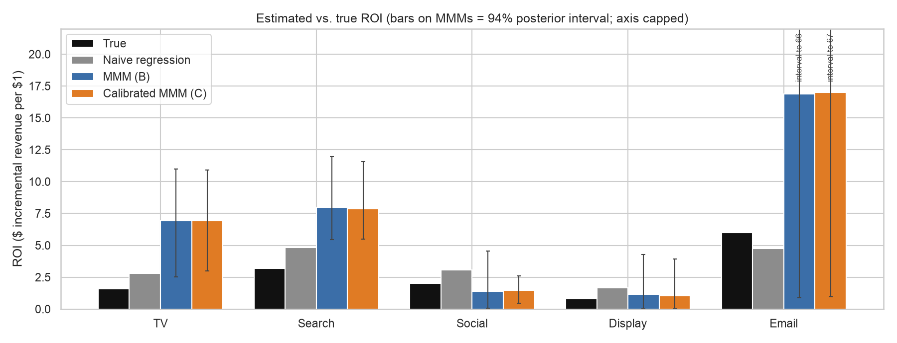
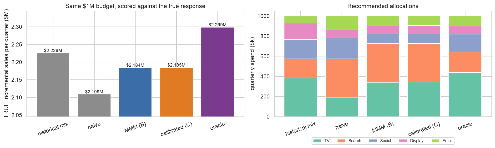
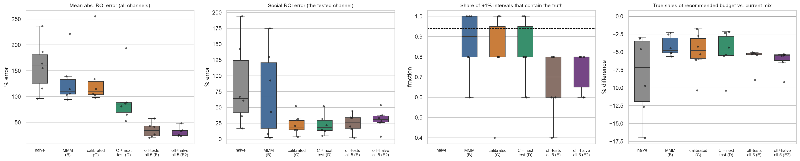
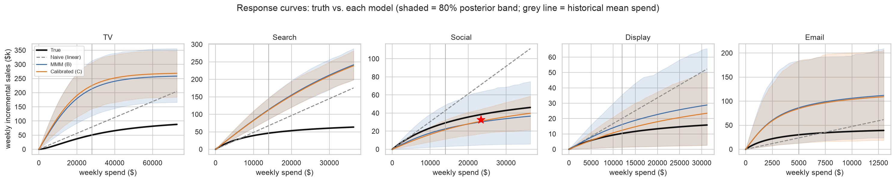
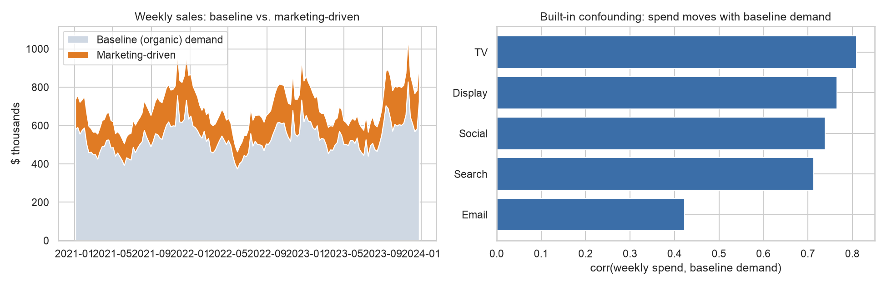
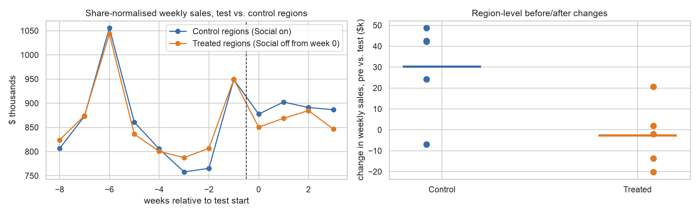

# Can an MMM Find the Truth? Calibrating a Media Mix Model with Lift Experiments

Marketers set budgets from media-mix-model (MMM) ROI estimates, but those estimates can be badly wrong when
spend tracks demand: companies spend more *because* sales are about to be high, so a model can credit channels for
sales that would have happened anyway. **Does calibrating the MMM with a small lift experiment fix its ROI estimates,
and does that make budget decisions better?**

Because the world here is simulated, the true ROI of every channel is known, so every estimate and every budget can be
scored against the truth. Everything is in one notebook, [`mmm_calibration.ipynb`](mmm_calibration.ipynb), run top to bottom.

## What I found

Short version: **calibration fixed the channel that was tested, did not fix the others, and did not make budgets
better than simply keeping the current mix.** The details matter, so here they are.

**1. ROI estimates (main world, seed 42).** The naive regression overstates the channels that spend in peak season;
the Bayesian MMM with default priors is *further* off for several channels, and attributes 61% of all sales to
marketing when the truth is 23%.

| Channel | True ROI | Naive regression | MMM (B) | Calibrated MMM (C) |
|---|---:|---:|---:|---:|
| TV | 1.6 | 2.81 | 6.93 | 6.95 |
| Search | 3.2 | 4.82 | 7.97 | 7.87 |
| Social *(tested)* | 2.0 | 3.05 | 1.40 | 1.48 |
| Display | 0.8 | 1.68 | 1.15 | 1.03 |
| Email | 6.0 | 4.74 | 16.89 | 16.98 |
| **Mean abs. % error** | | **62%** | **147%** | **144%** |

ROI = incremental revenue per $1 of spend. In this single world the naive model has the lowest average error; across six
fresh worlds the ordering flips (below), so I would not read much into any one world.



**2. Across six fresh worlds** (means; seed 42 is excluded because I developed the pipeline on it):

| Model | Mean ROI error | **Social** error (tested) | Display error (correlated) | 94% intervals containing truth | Budget vs. naive | Budget vs. current mix |
|---|---:|---:|---:|---:|---:|---:|
| Naive regression | 159% | 86% | 342% | n/a | 0 | -8.4% |
| MMM (B) | 130% | 75% | 109% | 87% | +4.8% | -4.2% |
| **Calibrated (C)**, Social test | 135% | **23%** | 165% | 80% | +3.9% | -5.1% |
| C + test on the next-most-uncertain channel (D) | 95% | 23% | 179% | 83% | +4.0% | -5.0% |
| Off-tests on all 5 channels (E) | 35% | 25% | 62% | 67% | +3.1% | -5.8% |
| Off + halve-spend tests on all 5 (E2) | 32% | 31% | 35% | 73% | +2.6% | -6.2% |

- **The tested channel improves a lot.** Social's ROI error fell from 75% to 23% on average (lower in 4 of 6 worlds).
- **The hypothesis that calibration helps *correlated* channels was not supported.** Display (highly correlated with Social)
  improved in the main world (43% to 29%) but got *worse* on average across fresh worlds (109% to 165%; better in only 1 of 6).
- **Testing every channel does fix ROI levels** (mean error 130% down to 35% across fresh worlds; in the main world its marketing
  share of sales was 22% vs. a true 23%), but the stated 94% intervals then contain the truth only 67-73% of the time, so the model
  becomes more precise and *overconfident*.
- **Budgets.** I optimized a fixed **$1M quarter** with each model (no channel more than doubled or halved) and scored every
  allocation against the *true* response curves. In the main world the calibrated MMM's budget delivered **+3.6% more true
  incremental sales than the naive model's**, the same as the uncalibrated MMM (+3.6%); across fresh worlds, +3.9% vs. +4.8%.
  So calibration did not improve the MMM's own budget.
- **But no model's budget beat keeping the current mix in any of the six worlds (0/6 for every row above).** In this simulation
  the current mix is already close to optimal: knowing the true curves improves on it by only **3.3%**, so any noticeable
  estimation error costs more than a reallocation can earn. The result is about this world, not about MMM in general.





**3. Why test results didn't translate into budgets (hypotheses supported by the diagnostics, not proven).**
A switch-off test measures a channel's *average* return, but a budget optimizer follows the *marginal* return (the slope of
the response curve at current spend). In the main world, even with off-tests on every channel, the model's marginal-ROI
ranking was wrong (it ranked TV last; the truth ranks it second), and its budget scored exactly the same true sales as the
naive model's ($2,109,054). Two things plausibly contribute: a 4-week window under-measures slowly decaying channels like TV (carry-over),
and a single off-test does not pin down curvature. Adding a halve-spend test to each channel (E2) lowered ROI error slightly
(35% to 32%) but did not improve budgets, so the notebook does not show that two-level tests fix this.



## How the experiment is built

1. **A simulated world** (3 years of weekly data, 5 channels: TV, Search, Social, Display, Email). Each channel has its own
   true adstock decay, saturation curve and ROI; ROI is fixed by construction. Baseline sales have trend, yearly seasonality,
   holiday spikes and an *unobserved demand shock*. **Spend is confounded:** planners spend ahead of peak season (3-week lead),
   chase recent demand, and Social/Display share a campaign-flighting factor (pairwise spend correlations up to 0.9).
2. **Model A:** OLS of sales on spend.
3. **Model B:** Bayesian MMM ([PyMC-Marketing](https://github.com/pymc-labs/pymc-marketing): geometric adstock, logistic
   saturation, Fourier seasonality, trend and holiday controls, default priors).
4. **Geo-lift test:** Social switched off in 5 of 10 regions (paired by size, randomized within pairs) for 4 weeks; effect
   measured by difference-in-differences against 8 pre-weeks, with a standard error from the region-level spread.
5. **Model C:** the same MMM also conditioned on the test, via PyMC-Marketing's lift-test likelihood.
6. **Budget optimization** with `scipy.optimize`, scored against the true curves.
7. **Stress tests:** informed priors, an oracle control, a follow-up test chosen by a rule fixed in advance, tests on all
   channels, and six fresh worlds.
8. **A one-page recommendation** for a marketing VP, generated from the results.





## Caveats

- **One data-generating process.** All seven worlds share the same true channel parameters; seeds change the noise, spend
  paths, test randomization and test error. This checks robustness to sampling variation, not to different marketing
  structures. The optimization headroom (3.3%) is identical in every world for this reason.
- **Low headroom.** The current mix is near-optimal by accident of my parameter choices. A world where the status quo is badly
  misallocated would give a recommendation more room to help; that is the most important follow-up.
- **The model is deliberately misspecified relative to the truth** (truth: Hill curves, infinite adstock, multiplicative
  trend x season; model: logistic curves, truncated adstock, additive terms), as in real life. So I cannot attribute the
  MMM's errors purely to confounding: giving the model the true unobserved demand shock as a control (diagnostic "OC")
  cut mean ROI error from 147% to 121% and marketing share from 61% to 46%, but TV stayed overstated by nearly 5x. Baseline-vs-saturation
  identification and misspecification contribute too.
- **Test design is simple.** 5 vs. 5 regions, 4 weeks, 4% weekly regional noise (standard error about $12k/week per channel).
  The window under-measures slow-decaying channels. Tests on different channels are given independent noise. About one in five
  measured lifts (12 of 60 in the fresh worlds) came back with the *wrong sign* because of noise; PyMC-Marketing requires sign
  consistency, so these were passed as "indistinguishable from zero" (a tiny same-sign value with the full standard error)
  rather than dropped.
- **Sampler health is not perfect.** Default priors, 4 chains x 800 draws, target accept 0.95. Several fits show divergences
  (from 0 to 228 of 3,200 draws; the informed-prior variant B+ is the worst, with R-hat 1.10). Per-fit diagnostics are in the
  notebook. I did not tune the sampler or reparameterize.
- **Decided after seeing results.** The pipeline was built on seed 42, and several choices were made after looking at it:
  the informed-prior, oracle-control, follow-up-test and all-channel diagnostics; independent test noise per channel (the first
  version shared one noise draw across channels, which is unrealistic); the wrong-sign rule; and using a *halve* rather than +50%
  test as the second level after a power check (+50% tests had signal-to-noise below 1 for most channels). Summary numbers above
  use only seeds 1-6.
- **ROI levels should not be trusted** even where rankings are useful: the MMM's marketing share of sales is 61% vs. 23% true.
- Only PyMC-Marketing 0.19 was used (not Google Meridian); results may differ with other implementations or priors.

## Reproduce

```bash
python3 -m venv .venv && source .venv/bin/activate
pip install -r requirements.txt
jupyter nbconvert --to notebook --execute --inplace --ExecutePreprocessor.timeout=-1 mmm_calibration.ipynb
```

The first run fits about 38 Bayesian models (an hour or more on a laptop). Fits are cached in `cache/` (git-ignored), so
re-runs take a few minutes; set `FORCE_REFIT = True` in the first cell to redo them. If your machine is memory-constrained,
keep `cores=2` in `SAMPLER`: running four chains in parallel on an 8 GB laptop caused heavy swapping for me.

## Files

- `mmm_calibration.ipynb`: the whole analysis, executed, with outputs
- `figures/`: the charts above
- `requirements.txt`
