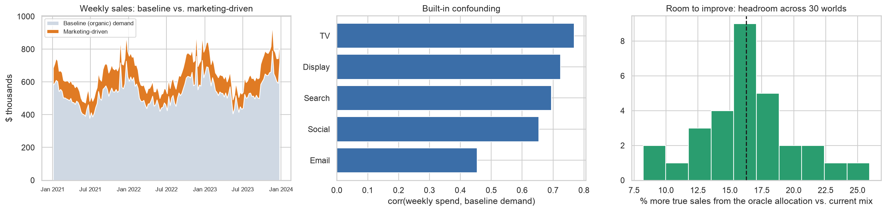

# Can an MMM Find the Truth? Calibrating a Media Mix Model with Lift Experiments

Marketing-mix models (MMMs) set real budgets, but they can be badly wrong when spend follows demand. This project asks: **does
calibrating a Bayesian MMM with geo-lift experiments fix its ROI estimates, and does that make budget decisions better?**
Everything is simulated, so the true ROI of every channel is known and every estimate and budget can be scored against the truth.

## TL;DR (six simulated worlds, each with different true parameters and a deliberately misallocated status quo)

- **MMM budgets beat the current mix in 6 of 6 worlds**, recovering **78%** of the achievable gain on average (naive regression: 57%). But it varies a lot by world (36% to 98%), and in the worked-example world the naive regression won (86% vs. 37%).
- **Lift tests fix what they measure.** One test (Social) cut Social's ROI error from 144% to 84% (better in 6/6 worlds) and did little elsewhere. Testing *every* channel cut overall ROI error from **265% to 71%** and the share of sales credited to marketing from 57% to 27% (truth: 17%).
- **Better ROI numbers did not make better budgets.** The plain MMM recovered 78% of the headroom; the all-channel-calibrated MMMs recovered 74-80%. Budgets depend on *marginal* returns, which a switch-off test does not pin down.


## Results across six fresh worlds (means)

| Model | ROI error | Sales credited to marketing (true 17%) | 94% intervals containing truth | Headroom recovered, mean (range) | Beats current mix |
|---|---:|---:|---:|---:|---:|
| Naive regression | 221% | n/a | n/a | 57% (35% to 70%) | 6/6 |
| MMM (B) | 265% | 57% | 73% | 78% (36% to 98%) | 6/6 |
| MMM + Social test (C) | 255% | 56% | 70% | 80% (54% to 99%) | 6/6 |
| C + test on the next-most-uncertain channel (D) | 182% | 42% | 73% | 75% (40% to 99%) | 6/6 |
| MMM + tests on all 5 channels (E) | **71%** | 27% | 57% | 76% (57% to 91%) | 6/6 |
| ROI prior only (R) | 152% | 35% | 87% | 53% (-6% to 89%) | 5/6 |
| Hill curves + all tests (HE) | **70%** | 27% | 77% | **80%** (65% to 96%) | 6/6 |
| Hill + ROI prior + all tests (HRE) | **66%** | 24% | 83% | 74% (32% to 93%) | 6/6 |

*Headroom recovered* = (true sales of the recommended $1M budget - true sales of the current mix) / (true sales of the best possible
budget - true sales of the current mix). The best possible budget adds 9% to 20% over the current mix in these worlds (mean 15%), under a
rule that lets a channel be halved or doubled. 100% = as good as knowing the truth; 0% = no better than leaving the budget alone.

## The worked-example world (seed 1)

True ROI vs. the three models the brief asked about (ROI = incremental revenue per $1):

| Channel | True ROI | Naive regression | MMM (B) | Calibrated MMM (C, Social test) |
|---|---:|---:|---:|---:|
| TV | 1.36 | 4.33 | 0.84 | 0.88 |
| Search | 4.85 | 14.77 | 8.89 | 8.83 |
| Social *(tested)* | 1.90 | 0.17 | 2.42 | 2.31 |
| Display | 0.37 | 0.55 | 1.32 | 1.27 |
| Email | 9.82 | 20.14 | 79.81 | 80.51 |
| **Mean abs. % error** | | **133%** | **224%** | **221%** |

Here the MMM is *worse* than the naive regression on ROI (it credits 61% of sales to marketing; the truth is 18%) and the calibrated
MMM's budget recovers 39% of the 21% headroom vs. 37% uncalibrated. In this one world the naive regression's budget recovered 86%,
because the status quo overspends Display so heavily that most of the gain is "cut Display, raise Search and Email", which even a crude
model gets right. Calibrating all five channels recovered 91%; giving the model the true unobserved demand shock recovered 96%.


<details>
<summary><b>More charts</b> (response curves, budget comparison, world, geo test)</summary>





</details>

## What was tried, and what didn't work

- **Hill curves alone made it worse.** The truth uses Hill curves (TV is S-shaped), so a Hill MMM looked like an obvious fix. In the worked example it credited 156% of sales to marketing (mean ROI error 823%): more flexible curves with default priors have even less to anchor them. It only helps once the model is anchored by experiments (HE, HRE).
- **An ROI-style prior fixes over-attribution but not budgets.** It cut the credited marketing share from 57% to 35% and ROI error from 265% to 152%, but recovered only 53% of the headroom.
- **Dropping the first weeks of a geo test matters for slow channels.** Carry-over means a cut takes weeks to develop. For TV (decay about 0.65) in the worked example, analysing all 8 test weeks measured 64% of a full cut's effect; analysing only the last 4 measured 89%.
- **Giving the model the true unobserved confounder (oracle control; worked example only, one world)** brought the budget to 96% of the achievable gain while ROI levels stayed off (mean error 117%), which suggests the budget mistakes come mainly from confounding and the ROI-level errors from elsewhere.

## How it works

1. **World:** 156 weeks, five channels (TV, Search, Social, Display, Email). Each world draws its own adstock, saturation and ROI per channel. Spend is confounded: planners spend 3 weeks ahead of seasonal peaks and chase last week's demand; Social/Display share a flighting factor.
2. **Models:** naive OLS; PyMC-Marketing MMM (geometric adstock, logistic or Hill saturation, Fourier seasonality, trend, holiday controls).
3. **Geo-lift tests:** a channel is switched off in 5 of 10 regions (paired by size, randomized within pairs) for 8 weeks; the last 4 are analysed by difference-in-differences. The result goes into the model as PyMC-Marketing's lift-test likelihood.
4. **Budget:** `scipy.optimize` over a fixed $1M quarter, every allocation scored against the true response curves.
5. **Code:** `src/mmmcal/` (world, geo test, fitting, budget, study design) with tests; `scripts/fit_study.py` fits and caches every model; the notebook loads them.

## Reproduce

```bash
python3 -m venv .venv && source .venv/bin/activate
pip install -r requirements.txt && pip install -e .
pytest                                        # fast tests; add `-m slow` for the model-fitting tests
python scripts/fit_study.py main              # worked-example world (10 models)
python scripts/fit_study.py robust            # six fresh worlds (42 models)
jupyter nbconvert --to notebook --execute --inplace mmm_calibration.ipynb
```

Fitting all 52 models takes roughly 3-4 hours of compute on a laptop; fits are cached in `cache/` (keyed on a hash of the data and settings), so re-running the notebook takes a few minutes.
Keep the machine awake and plugged in while fitting. On an 8 GB machine, keep `cores=2` in the sampler settings.

<details>
<summary><b>Caveats (please read before trusting any number)</b></summary>

- **Simulation, one family of worlds.** True parameters are drawn from ranges I chose, and the status quo is deliberately misallocated (Display overspent, Search and Email underspent). Those ranges were set by looking only at the true response curves, before any model was fitted, to get a median headroom of about 16%. Results describe this family of worlds, not marketing in general.
- **The planning rule favours simple moves.** Channels may be halved or doubled. When the status quo is this skewed, most of the achievable gain is the same few corner moves, which crude models also find. Compare models with that in mind (naive recovered 35% to 70% in the fresh worlds and 86% in the worked example).
- **Small number of worlds.** Six fresh worlds plus one worked example. Win-counts such as 4/6 are not statistically conclusive; per-world variation in headroom recovered is large.
- **Misspecification is deliberate.** Truth: Hill curves, infinite adstock, multiplicative trend x season. Default model: logistic curves, truncated adstock, additive terms.
- **The ROI prior is an approximation.** An exact ROI term added to the model graph does not work with PyMC-Marketing 0.19 (NUTS cannot be assigned and PyMC falls back to Metropolis), so the prior is placed on each channel's saturation scale, centred so a typical channel implies ROI = 2 (same for every channel, weak: 95% range about 0.5 to 8.7).
- **PyMC-Marketing's `MMM` class is deprecated** and removed in 0.20. Versions are pinned (`pymc-marketing==0.19.2`); porting to the multidimensional MMM is future work.
- **Test design is simple.** 10 regions, 5 treated, 4% weekly regional noise, independent noise per channel, switch-off only. One of 30 switch-off tests in the fresh worlds measured a lift of the wrong sign (pure noise); it was passed to the model as "indistinguishable from zero" (a tiny same-sign value with its full standard error) rather than dropped. A halve-spend test was explored (low power: +50% tests are mostly noise) but is not used by the headline models.
- **Sampler health.** 4 chains, 2,000 tuning + 1,000 draws, target accept 0.98. Across the 42 fresh-world fits: max R-hat 1.010; 257 divergences in total (about 0.15% of draws); 7 fits had more than 20. The first version of this project used lighter settings and had up to 228 divergences in 3,200 draws.
- **Decisions made after seeing results.** The worlds, headroom, planning rule, test window and washout were set in response to the first version's finding that the status quo was near-optimal (3.3% headroom) so no model could beat it. Which variants (R, HE, HRE) were run in the fresh worlds was chosen from the worked-example results (Hill alone was excluded because it blew up there). The VP memo uses the experiment-based model with the lowest ROI error across the fresh worlds, a rule fixed before looking at its budget results. The pipeline was developed on seed 1. No model was fitted on seeds 11-16 until the final run (their true curves were part of the headroom check used to set the design).
- **Reproducibility:** worlds, tests and fits are seeded, so a re-run with the same package versions should reproduce them closely (MCMC with parallel chains can differ in the last digits).

</details>

## Files

- `mmm_calibration.ipynb`: the full analysis, executed, with the VP recommendation at the end
- `src/mmmcal/`: simulation, geo tests, fitting helpers, budget optimiser, study design
- `tests/`: fast tests and slow model-fitting tests (`pytest -m slow`)
- `scripts/fit_study.py`: resumable fitting of every model in the study
- `figures/`, `requirements.txt` (exact versions)
